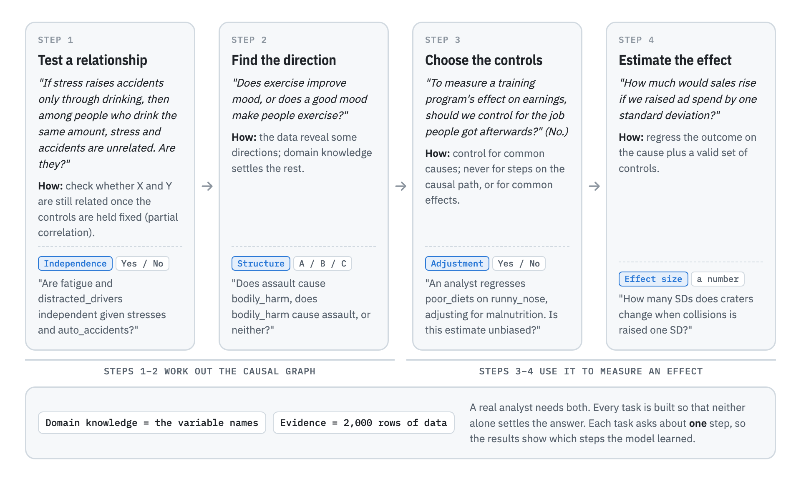
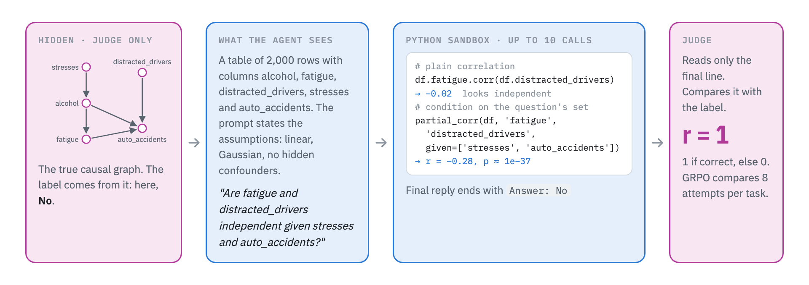
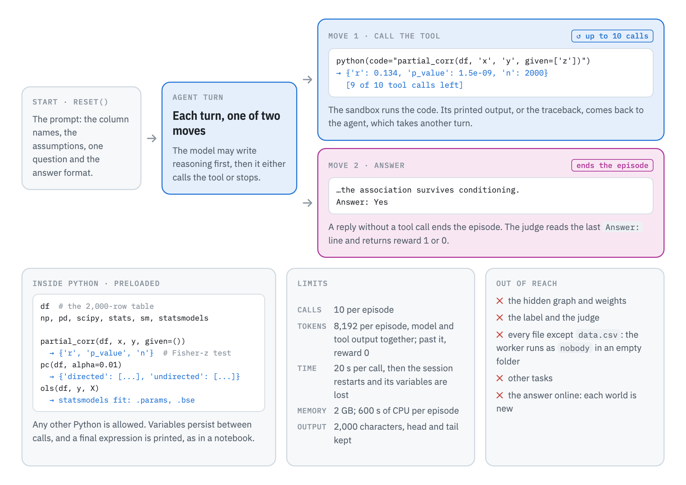
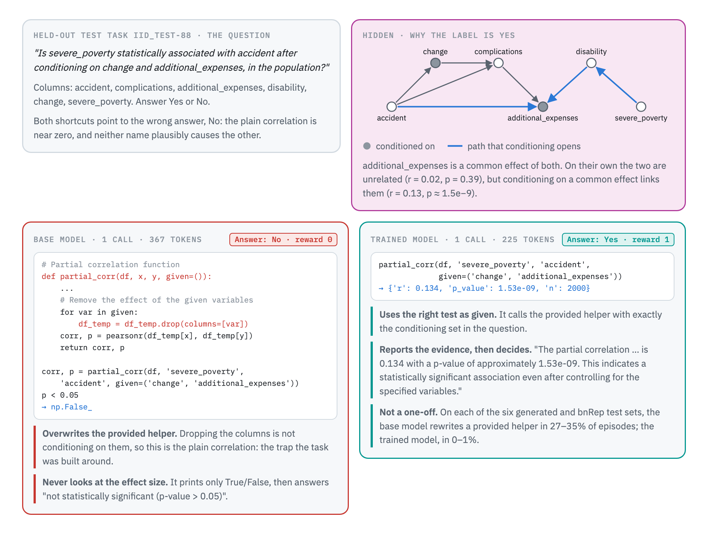
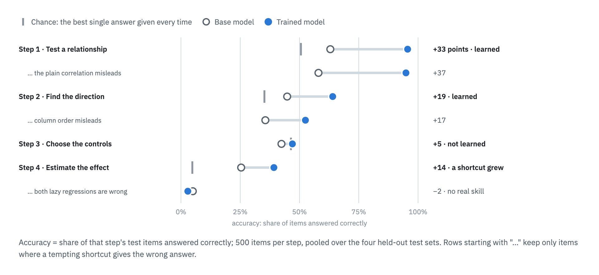
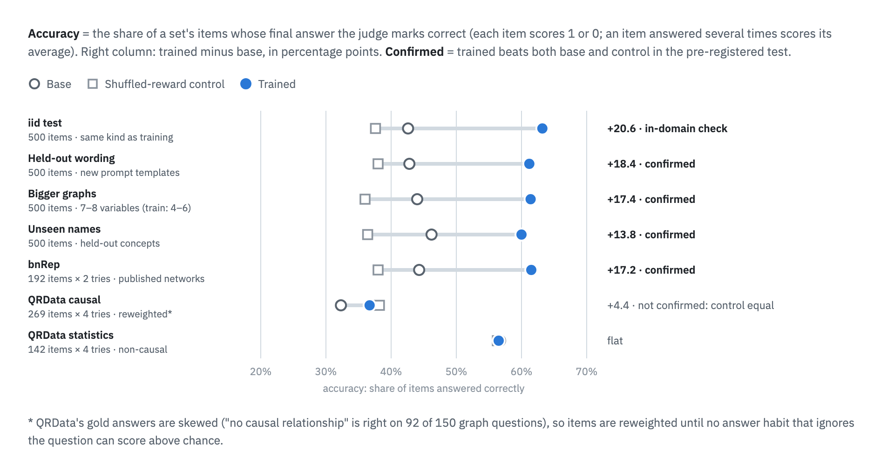
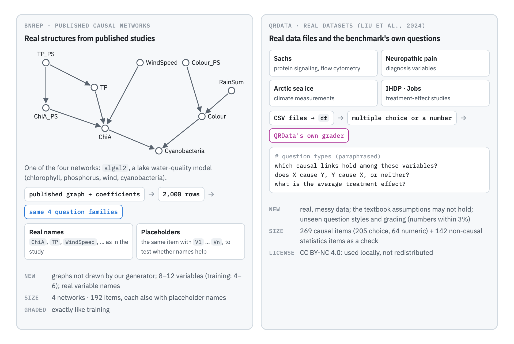
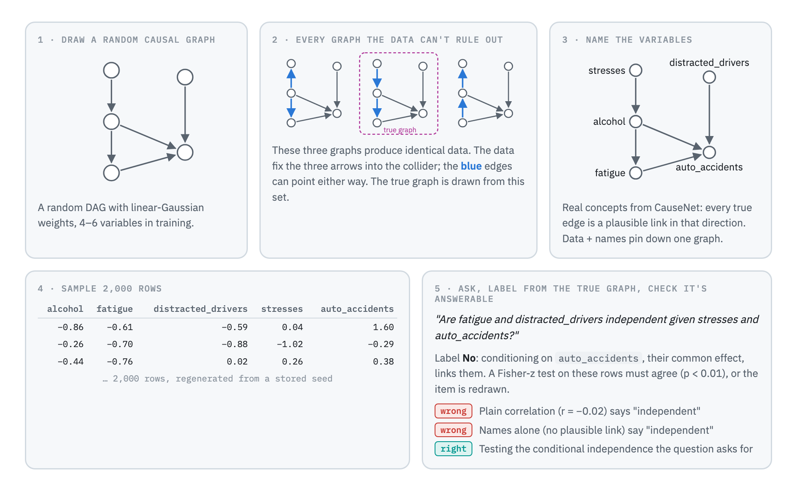
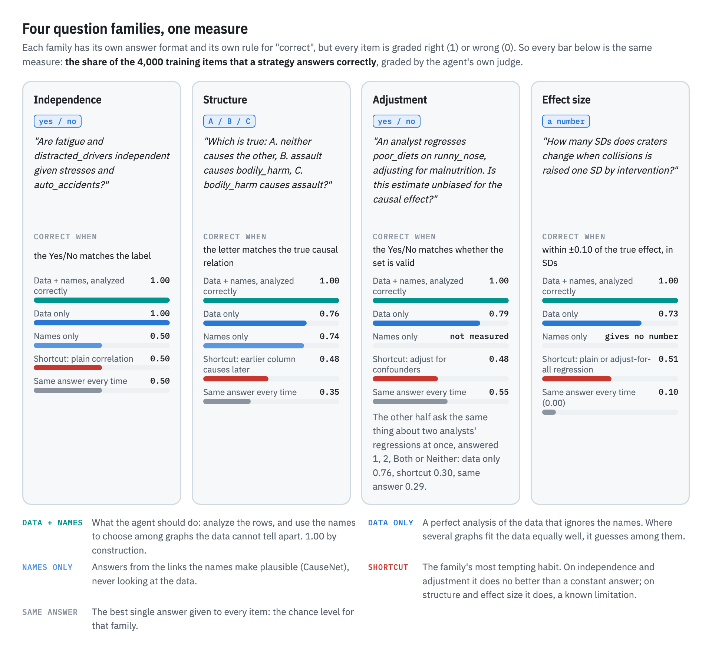
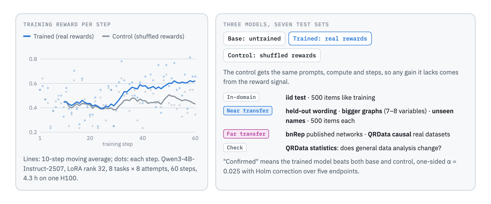

# CausalAgentBench

**An RL environment that trains LLM agents to answer causal questions from data, the way an analyst would.**

[](https://github.com/Ruichu-Xia/causal-agent-benchmark/actions/workflows/ci.yml)


Ask an LLM agent a causal question about a dataset, such as "does X affect Y?" or "should I control for Z?",
and it often takes a shortcut. It reads off a correlation, or it answers from what the variable names suggest.
Both can be wrong: a correlation does not show cause and effect, and a link that sounds plausible may not be in
the data.

This environment rewards the steps a trained analyst follows instead. Each task is a small simulated world
with a known causal answer. The agent gets a table and one question, writes Python to analyze the data, and
its final answer is graded right or wrong.

**The result in one sentence:** RL training made a 4B model reliably do the analysis steps it could already
sometimes do, and it failed on the step it could not do at all.

- Accuracy on held-out tasks rose from **43% to 63%**. The gain held for new wording, bigger graphs, unseen
  variable names and causal structures from published studies.
- **Learned:** testing whether two variables are still related once others are held fixed (63% → 96%), and
  telling which way cause and effect run (45% → 64%).
- **Not learned:** choosing which variables to control for. When asked for an effect size, the model learned
  a lazy shortcut instead.

Accuracy always means the share of questions answered correctly ([how answers are scored](#how-answers-are-scored)).

## The skill: an analyst's causal workflow

<picture>
  <source media="(prefers-color-scheme: dark)" srcset="docs/figures/workflow-dark.png">
  
</picture>

Each step guards against a common mistake:

1. **Test a relationship.** Two variables can look unrelated overall, yet become related once a third is held
   fixed, and the reverse. Only a test that holds the right variables fixed gives the right answer.
2. **Find the direction.** A correlation is the same in both directions. The direction has to come from
   patterns among several variables, or from domain knowledge.
3. **Choose the controls.** Controlling for the wrong variable distorts the answer. If a training program
   raises earnings by getting people better jobs, controlling for the job hides the program's effect.
4. **Estimate the effect.** The number is only right if the controls from step 3 are right.

Each task asks about one step. That way the results show which steps the model learned.

## One episode

<picture>
  <source media="(prefers-color-scheme: dark)" srcset="docs/figures/episode-dark.png">
  
</picture>

This is a step 1 task. The plain correlation between fatigue and distracted_drivers is near zero, so they look
unrelated. But both affect auto_accidents, and once auto_accidents is held fixed they become related. The
correct answer is "No, they are not independent". An agent that stops at the plain correlation answers "Yes"
and gets reward 0.

## What the agent can do

<picture>
  <source media="(prefers-color-scheme: dark)" srcset="docs/figures/actions-dark.png">
  
</picture>

The agent has one tool and one way to finish. Each turn it either calls `python(code)`, which runs real Python
in a sandbox with the table loaded as `df`, or it writes a final reply whose last line is `Answer: <x>`. That
reply ends the episode. The three helpers save typing, but the agent may write any analysis itself. It never
sees the hidden graph, the label, or any file other than its own `data.csv`.

## Before and after training: one task

<picture>
  <source media="(prefers-color-scheme: dark)" srcset="docs/figures/example-dark.png">
  
</picture>

The task is held-out step 1 task `iid_test-88`. Both models made one tool call.

- **Base model, wrong.** It wrote its own version of the `partial_corr` helper. That version deletes the
  columns it should hold fixed, so it measured the plain correlation, which is near zero. It answered "No".
- **Trained model, right.** It called the provided helper with exactly the variables named in the question,
  read the result (r = 0.134, p ≈ 1.5e−9), and answered "Yes". This is what an analyst would do.

The same change shows across all 500 tasks of the in-distribution test set:

| What the model did | Base | Trained |
| --- | ---: | ---: |
| Answered correctly | 42.6% | **63.2%** |
| Rewrote a provided helper instead of calling it | 27.0% | **0.2%** |
| Ran no code at all | 4.8% | **0.6%** |
| Ended without an `Answer:` line | 8.2% | **2.6%** |
| Reply length (median tokens) | 1,177 | 878 |

Not every correct answer is this clean. The trained model's replies are short, and it almost never uses the
`pc` helper (2 of 125 direction tasks). On `iid_test-65` it picked the right direction after looking only at
a plain correlation, which cannot show direction.

<details>
<summary>Full transcripts of <code>iid_test-88</code> (both models, verbatim)</summary>

**Base model**: one tool call, reward 0.

```python
import pandas as pd
import numpy as np
from statsmodels.stats.multitest import multipletests

# Check if there is a statistical association between severe_poverty and accident
# after conditioning on change and additional_expenses using partial correlation

# Partial correlation function
def partial_corr(df, x, y, given=()):
    from statsmodels.stats.weightstats import ztest
    from scipy.stats import pearsonr
    # Create a DataFrame with the variables of interest
    df_temp = df[[x, y] + list(given)]
    # Calculate the partial correlation
    corr, p = pearsonr(df_temp[x], df_temp[y])
    # Remove the effect of the given variables
    for var in given:
        df_temp = df_temp.drop(columns=[var])
    # Calculate the partial correlation
    corr, p = pearsonr(df_temp[x], df_temp[y])
    return corr, p

# Calculate partial correlation between severe_poverty and accident after conditioning on change and additional_expenses
corr, p = partial_corr(df, 'severe_poverty', 'accident', given=('change', 'additional_expenses'))

# Check if the p-value is significant (alpha = 0.05)
p_significant = p < 0.05

p_significant
```

```text
np.False_

[9 of 10 tool calls left]
```

> The partial correlation between severe_poverty and accident, after conditioning on change and
> additional_expenses, is not statistically significant (p-value > 0.05).
>
> Answer: No

**Trained model**: one tool call, reward 1.

```python
from statsmodels.stats.multitest import multipletests

# Check for partial correlation between severe_poverty and accident, conditioning on change and additional_expenses
partial_corr_result = partial_corr(df, 'severe_poverty', 'accident', given=('change', 'additional_expenses'))
partial_corr_result
```

```text
{'r': 0.13443173101003264, 'p_value': 1.5314485536753408e-09, 'n': 2000}

[9 of 10 tool calls left]
```

> The partial correlation between severe_poverty and accident, after conditioning on change and
> additional_expenses, is 0.134 with a p-value of approximately 1.53e-09. This indicates a statistically
> significant association even after controlling for the specified variables.
>
> Answer: Yes

</details>

## Results: which steps the model learned

### How answers are scored

Every episode earns reward 1 (correct) or 0 (wrong). A model's **accuracy** on a test set is the average
reward: the share of questions it answers correctly. Each step has its own answer format and its own rule for
"correct", but every rule ends in right or wrong, so accuracy means the same thing everywhere. Only the
reply's last `Answer:` line counts. A reply without one, or one cut off at 8,192 tokens, scores 0.

| Step | Answer | Correct when | Chance |
| --- | --- | --- | ---: |
| 1. Test a relationship | Yes / No | it matches the true answer | 0.51 |
| 2. Find the direction | A / B / C | it names the true causal relation | 0.35 |
| 3. Choose the controls | Yes / No, or 1 / 2 / Both / Neither for two analysts' regressions | it says correctly which regressions are unbiased | 0.46 |
| 4. Estimate the effect | a number | it is within ±0.10 of the true effect, in standard deviations | 0.05 |

**Chance** is the score of giving the best single answer to every test question. A model has learned
something only if it beats chance.

- **Attempts.** The four simulated test sets have 500 questions each, answered once. bnRep questions are
  answered twice and QRData questions four times; a question's score is the average of its attempts.
- **QRData** uses its own rule: the gold option, or within 3% of the gold number. Its gold answers are skewed
  ("no causal relationship" is right on 92 of 150 graph questions), so questions are reweighted until no
  answer habit can score above chance.

### Results by step

<picture>
  <source media="(prefers-color-scheme: dark)" srcset="docs/figures/steps-dark.png">
  
</picture>

RL only strengthens behavior that already earns reward. Each row follows from that:

- **Steps 1 and 2: learned.** The base model was above chance, so it sometimes did the right analysis.
  Training turned "sometimes" into "almost always" on step 1 and "more often" on step 2. The gains hold on the
  tasks where the tempting shortcut is wrong (the "…" rows), so they come from real analysis.
- **Step 3: not learned.** The base model was slightly below chance (0.42 vs 0.46). It almost never chose
  controls correctly, so there was no correct behavior for RL to strengthen.
- **Step 4: a shortcut grew.** The base model usually ran a lazy regression: Y on X alone, or Y on X and every
  other column. By a flaw in task generation, one of these is right on about half the tasks, so RL
  strengthened the habit. Where both lazy regressions are wrong, the trained model scores 3%, and 85% of its
  answers there equal a lazy regression's value.

This matches other findings that RL with right-or-wrong rewards mostly sharpens what a model can already do
([Yue et al., 2025](https://arxiv.org/abs/2504.13837)). It also says what the next version needs: reward step 3 directly, for example by asking the
model to name its controls and grading them.

## Does it hold outside the training tasks?

<picture>
  <source media="(prefers-color-scheme: dark)" srcset="docs/figures/results-dark.png">
  
</picture>

The model was trained on 4,000 simulated tasks with 4–6 variables. It was then tested on sets that differ from
training in one way at a time:

- **Held-out wording, bigger graphs (7–8 variables), unseen variable names:** still simulated, but new. The
  gain held on all three.
- **bnRep:** causal structures from four published studies, such as a lake water-quality model, with data
  simulated from them. The gain held (44% → 62%).
- **QRData:** real, messy datasets with their own questions. The trained model beat base by 4 points, but the
  shuffled-reward control (see [below](#was-the-gain-caused-by-the-reward)) scored just as well. So this gain
  cannot be credited to training.

### Why simulated worlds, and what that costs

On real data nobody knows the true causal answer, so an agent's answer cannot be graded exactly. Simulated
worlds give an exact answer for every question, and as many fresh tasks as training needs.

The cost is realism. Every relationship is linear with Gaussian noise, there are no hidden common causes, the
graphs are small, and the effect sizes are made up. So the honest claim is "the analyst workflow under
textbook assumptions". The two transfer tests measure the gap. Structures from real studies transferred; real,
messy datasets did not.

<picture>
  <source media="(prefers-color-scheme: dark)" srcset="docs/figures/transfer-dark.png">
  
</picture>

QRData ([Liu et al., 2024](https://github.com/xxxiaol/QRData)) is licensed CC BY-NC 4.0, so it is used locally
and never redistributed here.

## How a task is built

A task must have one exact answer, and only real analysis should reach it. So every world is built so that the
data alone and the names alone each fall short.

<picture>
  <source media="(prefers-color-scheme: dark)" srcset="docs/figures/generation-dark.png">
  
</picture>

- **Several graphs fit the same data.** Data can show that two variables are linked but often not which way.
  The true graph is drawn at random from all graphs that fit the data equally well.
- **Names break the tie.** Variables are named after real concepts from [CauseNet](https://causenet.org/), so
  every true cause is a plausible cause. Some plausible links are absent, so names alone mislead.
- **Every answer is checked against the task's own data.** A standard method (the PC algorithm, a
  partial-correlation test, or a regression) run on the 2,000 rows must reach the answer, or the task is
  redrawn. So a correct analysis is never marked wrong.

<picture>
  <source media="(prefers-color-scheme: dark)" srcset="docs/figures/families-dark.png">
  
</picture>

## Was the gain caused by the reward?

A trained model can improve just from extra practice with the format, without learning from the reward. Two
checks rule this out:

- **A shuffled-reward control.** A second model gets exactly the same training, except that each step's
  rewards are shuffled among its attempts. It practices just as much, but the reward no longer says which
  answers were right. It ended *below* the base model (38% vs 43%): its replies grew longer and about one in six
  ran out of tokens. So the trained model's gain came from the reward.
- **Pre-registration.** The test sets, the comparisons and the statistical tests were
  [written down](docs/preregistration_v3.md) before any test score was computed. A transfer test counts as
  **confirmed** only if the trained model beats both the base model and the control.

<picture>
  <source media="(prefers-color-scheme: dark)" srcset="docs/figures/study-dark.png">
  
</picture>

Training: Qwen3-4B-Instruct-2507 with LoRA (rank 32), 60 GRPO steps of 8 tasks × 8 attempts, 4.3 hours on one
H100. Four of the five pre-registered transfer tests were confirmed; QRData was not.

<details>
<summary>Full confirmatory results</summary>

Accuracy per arm, as defined in [How answers are scored](#how-answers-are-scored) (reweighted on QRData causal).
Differences are trained − comparator in percentage points with 95% cluster-bootstrap intervals;
an endpoint is confirmed when it beats both comparators (one-sided sign-flip test, Holm over five endpoints at
α = 0.025). One training run per arm.

| Set | Base | Trained | Control | Trained − base | Trained − control | Result |
| --- | ---: | ---: | ---: | --- | --- | --- |
| iid test (manipulation check) | 0.426 | 0.632 | 0.376 | +20.6 [+15.4, +25.8] | | passes |
| Held-out wording | 0.428 | 0.612 | 0.380 | +18.4 [+13.6, +23.2] | +23.2 [+18.2, +28.2] | confirmed |
| Bigger graphs (7–8 variables) | 0.440 | 0.614 | 0.360 | +17.4 [+12.0, +22.8] | +25.4 [+20.4, +30.2] | confirmed |
| Unseen names | 0.462 | 0.600 | 0.364 | +13.8 [+8.8, +18.8] | +23.6 [+18.4, +28.8] | confirmed |
| bnRep, real names | 0.443 | 0.615 | 0.380 | +17.2 [+11.5, +22.9] | +23.4 [+16.4, +30.2] | confirmed |
| QRData causal | 0.323 | 0.367 | 0.382 | +4.4 [+0.5, +8.8] | −1.4 [−6.0, +3.1] | not confirmed |
| QRData statistics (exploratory) | 0.567 | 0.565 | 0.563 | | | |
| bnRep, placeholder names (exploratory) | 0.401 | 0.609 | 0.341 | | | |

Details, scope conditions and deviations: [docs/results_v3.md](docs/results_v3.md).

</details>

## Environment at a glance

| Part | Implementation |
| --- | --- |
| Task data | One JSON row per task: the prompt, the hidden world (true graph, weights, seed) and the answer. 4,000 training tasks with 4–6 variables. |
| Prompt | States the assumptions (linear, Gaussian, no feedback loops, no hidden common causes), what the names mean, one question, and the answer format `Answer: <x>`. |
| Tool | One `python` tool: a persistent session with `df` loaded, numpy, pandas, scipy, statsmodels and the helpers `partial_corr`, `pc` and `ols`. Up to 10 calls. |
| Sandbox | A worker process running as `nobody`, in an empty folder holding only `data.csv`, with a cleared environment. A call that runs past 20 s restarts the session. The worker gets 2 GB of memory and 600 s of CPU, and output is cut at 2,000 characters. All model code runs in Modal containers, and an isolation test checks that the tool cannot read task files. |
| Judge | `grade_reply` runs in the trainer process and reads only the final reply's text: exact match for Yes/No and letters, ±0.10 for numbers. The answer never enters the sandbox. |
| Trainer | TRL `GRPOTrainer(environment_factory=DataEnv)`. Evaluation drives the same `DataEnv` over vLLM, so training and evaluation share one prompt, tool and judge. |

## Limitations and next steps

- **Step 4 rewards a shortcut.** A lazy regression is right on about half the effect-size tasks, and the model
  learned it. Next: make most effect tasks ones where both lazy regressions are wrong, or grade the controls too.
- **Step 3 was not learned.** The base model was at chance, so RL had nothing to strengthen. Next: reward step 3
  directly, or start from a model that sometimes gets it right.
- **Column order gives away direction.** Causes usually come in earlier columns, so "the left column causes the
  right" is right on 48% of direction tasks (chance 35%). Gains hold where this rule is wrong, but the next
  build should shuffle columns.
- **Realism.** Linear, Gaussian, small graphs, no hidden common causes. Transfer to real datasets (QRData) was
  not confirmed.
- **One training run per model**, and the trained checkpoint was chosen on development sets. QRData may appear
  in Qwen3's training data.
- **Sandbox.** The network is left open; nothing secret is reachable from it.

## Try it

Python 3.12+ and [uv](https://docs.astral.sh/uv/).

```bash
uv sync
```

**Run one episode locally, no GPU needed.** `data/v3_sample.jsonl` holds nine training tasks. The tool calls
below are written by hand; model-written code should run only inside the sandboxed containers.

```python
import json
from causalagentbench import DataEnv, reward_func

tasks = [json.loads(line) for line in open("data/v3_sample.jsonl")]
env = DataEnv(tasks)
print(env.reset(index=0))  # the prompt: a question about fatigue and distracted_drivers
print(env.python("partial_corr(df, 'fatigue', 'distracted_drivers', given=['stresses', 'auto_accidents'])"))
# {'r': -0.2798, 'p_value': 1.0e-37, 'n': 2000}  [9 of 10 tool calls left]
print(reward_func(["Conditioning on their common effect links them.\nAnswer: No"], [env]))  # [1.0]
```

**Build the task splits.** Needs the CauseNet-Precision dump from [causenet.org](https://causenet.org/).

```bash
uv run python scripts/build_tasks.py --out-dir outputs/dataenv/v3 --train 4000 --dev 200 --test 500 --workers 8
uv run python scripts/build_transfer.py --out-dir outputs/dataenv/transfer --per-family 12 \
    --qrdata <QRData's benchmark/ directory, with data/ unzipped>
```

**Train and evaluate on Modal**, where all model-written code runs:

```bash
uv run --with modal modal deploy scripts/modal_app.py
uv run --with modal modal run scripts/modal_app.py::isolation_main      # the sandbox must fail to read secrets
uv run --with modal modal run scripts/modal_app.py::train_main --dataset outputs/dataenv/v3/train.jsonl \
    --run data-pilot --max-steps 60 --extra "--revision <sha>"
uv run --with modal modal run scripts/modal_app.py::eval_main --tasks outputs/dataenv/v3/iid_test.jsonl \
    --name trained --revision <sha> --adapter data-pilot/adapter
```

**Reproduce the analysis** from recorded replies:

```bash
uv run python scripts/confirm.py analyze --control v3-control
uv run python scripts/explore.py --control v3-control
```

## How the project got here

| Version | Environment | What happened | Lesson |
| --- | --- | --- | --- |
| v1 | 10,000 rows, three fixed tools (`correlate`, `regress`, `discover`), report five signed effects | Error fell 0.20 in-domain; no confirmed transfer ([results](https://github.com/Ruichu-Xia/causal-agent-benchmark/blob/51850aa/docs/transfer_results.md)) | One rigid task and fixed tools train a narrow skill |
| v2 | Text only: a described graph, four question families | +1.9 points, not significant ([results](https://github.com/Ruichu-Xia/causal-agent-benchmark/blob/51850aa/docs/results_v2.md)) | Without data and a tool, there was little to learn |
| **v3** | Data, a general Python tool, four mixed question families | +20.6 in-domain; 4 of 5 transfer tests confirmed ([design](docs/environment_v3.md), [results](docs/results_v3.md)) | Keep data and tools; mix question types; balance shortcuts |

This repository holds v3 only. The code and write-ups of v1 and v2 are kept in the history, at commit
[`51850aa`](https://github.com/Ruichu-Xia/causal-agent-benchmark/tree/51850aa).

## Repository layout

```text
src/causalagentbench/
  environment.py   DataEnv: the episode (prompt, python tool, final answer) and its reward
  sandbox.py       the python tool: a restricted worker process per episode
  grading.py       reads the final "Answer:" line and grades it
  world.py         a simulated world: random graph, its equivalence class, names and 2,000 rows
  families.py      the four question families, with shortcut balancing and the answerability check
  wording.py       paraphrase templates, some held out of training
  dataset.py       builds and loads task splits
  graphs.py        d-separation, valid adjustment, equivalence classes
  scm.py           linear-Gaussian models: draw correlations, realize weights
  causenet.py      names variables with CauseNet concepts
  audit.py         how often single sources and shortcuts are right
  bnrep.py         transfer tasks on published networks
  qrdata.py        QRData loader and its grading rule
scripts/           build tasks, train (TRL GRPO), evaluate on Modal, pre-registered analysis
docs/              design, pre-registration, results, and the README figures
data/              sample tasks and the bnRep networks
tests/             environment, sandbox, grading, graphs, naming and analysis
```

## Development

```bash
uv sync
uv run pytest -q
uv run ruff check src tests scripts && uv run mypy src
uv run --with pillow python docs/figures/render.py    # re-render the README figures (needs Google Chrome)
```

Code is Apache-2.0. CauseNet-derived data is CC BY 4.0; see [data/README.md](data/README.md). QRData is
CC BY-NC 4.0 and is not included.
