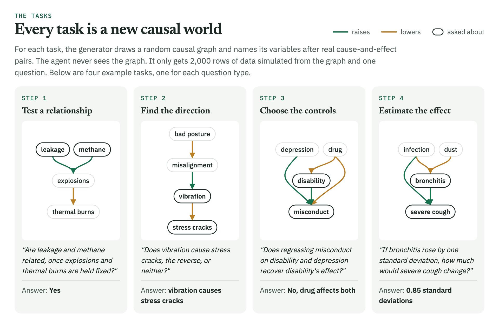

# CausalAgentBench

**An RL environment and benchmark for training LLM agents to answer causal questions from data the way a data scientist would.**

[](https://github.com/Ruichu-Xia/causal-agent-benchmark/actions/workflows/ci.yml)


<picture>
  <source media="(prefers-color-scheme: dark)" srcset="docs/figures/hero-dark.png">
  
</picture>

When an LLM agent answers a causal question about a dataset, such as whether one variable affects another, it
often takes a shortcut. It reads the answer off a correlation, or it guesses from what the variable names
suggest, and both can be wrong. I built this environment to reward the steps an experienced data scientist
follows instead. Every task comes from a simulated causal world, so each answer can be graded exactly against the
truth.

Training a 4B model on these tasks with RL raised its accuracy on held-out tasks from **43% to 63%**, and the
gain carried over to new wording, larger graphs, unseen variable names and causal structures from published
studies. The improvement came from steps the model could already do some of the time. It became much better at
testing whether two variables are related once others are held fixed (63% to 96%) and at telling which way a
causal link runs (45% to 64%). It did not learn to choose which variables to control for, and on effect-size
questions it learned a shortcut instead of the full analysis.

## How it works

<picture>
  <source media="(prefers-color-scheme: dark)" srcset="docs/figures/episode-dark.png">
  
</picture>

Each episode gives the agent a table of 2,000 rows and one question. The agent investigates by calling
`python(code)` up to 10 times. The code runs in a sandbox with the table loaded as `df`, along with pandas,
scipy, statsmodels and three helper functions. The agent finishes with a reply whose last line states its
answer, and the judge compares only that line with the true answer to return a reward of 1 or 0. The true graph
and answer stay outside the sandbox, so the only way to the answer is through the data.

## Four questions, one causal analysis workflow

A causal analysis usually moves through four steps, and each task asks about one of them. This makes it possible
to see which steps training actually improved.

| Step | Example question | Answer | Mistake it catches | Chance |
| --- | --- | --- | --- | ---: |
| 1. Test a relationship | Are X and Y related once Z is held fixed? | Yes / No | trusting the plain correlation | 51% |
| 2. Find the direction | Does X cause Y, Y cause X, or neither? | A / B / C | reading direction off a correlation | 35% |
| 3. Choose the controls | Does regressing Y on X and Z recover X's effect? | Yes / No, or which of two analysts | controlling for the wrong variable | 46% |
| 4. Estimate the effect | How much does Y change if X rises by one standard deviation? | a number | a biased estimate from wrong controls | 5% |

**Accuracy** is the share of questions answered correctly. **Chance** is the score a model would get by giving the
same answer to every question, picking whichever answer is correct most often. A model has only learned something
if it scores above chance. A numerical answer counts as correct within 0.10 standard deviations of the truth, and
a reply without a final answer line scores 0.

## What training changed

<picture>
  <source media="(prefers-color-scheme: dark)" srcset="docs/figures/steps-dark.png">
  
</picture>

RL can only strengthen behavior that already earns reward, and that explains each result. In steps 1 and 2 the
base model sometimes did the right analysis, and training turned it into a habit. In step 3 the base model was at
chance, so there was no correct behavior for training to strengthen. In step 4, a lazy regression of Y on X
alone, or on every other column, happened to be right on about half the tasks, and training reinforced it. On
the tasks where that shortcut is wrong, the trained model scores only 3%. This matches other findings that RL
with right-or-wrong rewards mostly sharpens what a model can already do
([Yue et al., 2025](https://arxiv.org/abs/2504.13837)).

### Before and after, on one task

<picture>
  <source media="(prefers-color-scheme: dark)" srcset="docs/figures/example-dark.png">
  
</picture>

On this held-out task, the base model wrote its own version of the partial correlation helper. Its version
deleted the columns it was supposed to hold fixed, so it measured the plain correlation and answered incorrectly.
The trained model called the provided helper with exactly the variables in the question and answered correctly.
The same change in behavior shows across all 500 held-out tasks.

| Across the 500 held-out tasks | Base | Trained |
| --- | ---: | ---: |
| Answered correctly | 42.6% | **63.2%** |
| Rewrote a provided helper instead of calling it | 27.0% | **0.2%** |
| Ended without an `Answer:` line | 8.2% | **2.6%** |

Not every correct answer is this careful. On direction questions, the trained model almost never uses the `pc`
helper, which runs a standard causal discovery algorithm (2 of 125 tasks).

## Does it generalize?

<picture>
  <source media="(prefers-color-scheme: dark)" srcset="docs/figures/transfer-dark.png">
  
</picture>

Each test set differs from training in one way. To check that the gain came from the reward and not from extra
practice, I also trained a control model with identical settings but shuffled rewards. The control ended below
the base model (38% vs 43%), so practice alone did not help. The test sets, comparisons and statistical tests
were [pre-registered](docs/preregistration_v3.md) before any test score was computed, and a transfer result
counts as confirmed only when the trained model beats both the base and control models. The gain held on four
of the five transfer sets. On QRData, which uses real and messy datasets, the trained model beat the base model by
4 points, but the control did equally well, so that gain cannot be credited to training.

Training used Qwen3-4B-Instruct-2507 with LoRA (rank 32) and GRPO for 60 steps of 8 tasks with 8 attempts each,
which took 4.3 hours on one H100.

## How a task is built

<picture>
  <source media="(prefers-color-scheme: dark)" srcset="docs/figures/generation-dark.png">
  
</picture>

On real data nobody knows the true causal answer, so answers cannot be graded exactly. Simulated worlds provide
an exact answer for every question and as many new tasks as training needs. I built each world so that neither
the data alone nor the variable names alone are enough to answer, and I checked every answer against the task's
own data so that a correct analysis is never marked wrong. The cost is realism, since every relationship is
linear with Gaussian noise, there are no hidden common causes and the graphs are small.

## Limitations

- Effect questions still reward a shortcut, because a lazy regression is right on about half of them. The next
  version should make most effect tasks ones where both lazy regressions are wrong, or also grade the chosen
  controls.
- Choosing controls was not learned. Rewarding that step directly, or starting from a model that sometimes gets it
  right, would give training something to strengthen.
- Column order leaks direction, since causes tend to appear in earlier columns. Guessing that the left column
  causes the right one is correct on 48% of direction tasks, against 35% for chance. The gains hold on tasks where
  this guess is wrong, but the next version should shuffle columns.
- The worlds are linear and Gaussian with small graphs and no hidden causes, and transfer to real datasets was
  not confirmed.
- Each model was trained once, and the checkpoint was chosen on development sets.

## Try it

The project needs Python 3.12+ and [uv](https://docs.astral.sh/uv/).

```bash
uv sync
```

You can run one episode locally without a GPU. The tool calls below are written by hand, since model-written code
should only run inside the sandboxed containers.

```python
import json
from causalagentbench import DataEnv, reward_func

tasks = [json.loads(line) for line in open("data/v3_sample.jsonl")]
env = DataEnv(tasks)
print(env.reset(index=0))  # the prompt: a question about fatigue and distracted_drivers
print(env.python("partial_corr(df, 'fatigue', 'distracted_drivers', given=['stresses', 'auto_accidents'])"))
# {'r': -0.2798, 'p_value': 1.0e-37, 'n': 2000}  [9 of 10 tool calls left]
print(reward_func(["Conditioning on their common effect links them.\nAnswer: No"], [env]))  # [1.0]
```

<details>
<summary>Build the tasks, train and evaluate on Modal, reproduce the analysis</summary>

Building tasks needs the CauseNet-Precision dump from [causenet.org](https://causenet.org/).

```bash
uv run python scripts/build_tasks.py --out-dir outputs/dataenv/v3 --train 4000 --dev 200 --test 500 --workers 8
uv run python scripts/build_transfer.py --out-dir outputs/dataenv/transfer --per-family 12 \
    --qrdata <QRData's benchmark/ directory, with data/ unzipped>

uv run --with modal modal deploy scripts/modal_app.py
uv run --with modal modal run scripts/modal_app.py::isolation_main      # the sandbox must fail to read secrets
uv run --with modal modal run scripts/modal_app.py::train_main --dataset outputs/dataenv/v3/train.jsonl \
    --run data-pilot --max-steps 60 --extra "--revision <sha>"
uv run --with modal modal run scripts/modal_app.py::eval_main --tasks outputs/dataenv/v3/iid_test.jsonl \
    --name trained --revision <sha> --adapter data-pilot/adapter

uv run python scripts/confirm.py analyze --control v3-control
uv run python scripts/explore.py --control v3-control
```

</details>

<details>
<summary>Full confirmatory results</summary>

Accuracy per arm (reweighted on QRData causal so that no answer habit scores above chance). Differences are
trained − comparator in percentage points with 95% cluster-bootstrap intervals; an endpoint is confirmed when it
beats both comparators (one-sided sign-flip test, Holm over five endpoints at α = 0.025). bnRep questions are
answered twice and QRData questions four times. One training run per arm.

| Set | Base | Trained | Control | Trained − base | Trained − control | Result |
| --- | ---: | ---: | ---: | --- | --- | --- |
| iid test (manipulation check) | 0.426 | 0.632 | 0.376 | +20.6 [+15.4, +25.8] | | passes |
| Held-out wording | 0.428 | 0.612 | 0.380 | +18.4 [+13.6, +23.2] | +23.2 [+18.2, +28.2] | confirmed |
| Bigger graphs (7–8 variables) | 0.440 | 0.614 | 0.360 | +17.4 [+12.0, +22.8] | +25.4 [+20.4, +30.2] | confirmed |
| Unseen names | 0.462 | 0.600 | 0.364 | +13.8 [+8.8, +18.8] | +23.6 [+18.4, +28.8] | confirmed |
| bnRep, real names | 0.443 | 0.615 | 0.380 | +17.2 [+11.5, +22.9] | +23.4 [+16.4, +30.2] | confirmed |
| QRData causal | 0.323 | 0.367 | 0.382 | +4.4 [+0.5, +8.8] | −1.4 [−6.0, +3.1] | not confirmed |
| QRData statistics (exploratory) | 0.567 | 0.565 | 0.563 | | | |
| bnRep, placeholder names (exploratory) | 0.401 | 0.609 | 0.341 | | | |

Details, scope conditions and deviations are in [docs/results_v3.md](docs/results_v3.md), and the design is
described in [docs/environment_v3.md](docs/environment_v3.md). QRData ([Liu et al., 2024](https://github.com/xxxiaol/QRData))
is CC BY-NC 4.0, so it is used locally and never redistributed here.

</details>

<details>
<summary>How the project got here</summary>

| Version | Environment | What happened | Lesson |
| --- | --- | --- | --- |
| v1 | 10,000 rows, three fixed tools, report five signed effects | Error fell 0.20 in-domain; no confirmed transfer ([results](https://github.com/Ruichu-Xia/causal-agent-benchmark/blob/e2020db/docs/transfer_results.md)) | One rigid task and fixed tools train a narrow skill |
| v2 | Text only: a described graph, four question families | +1.9 points, not significant ([results](https://github.com/Ruichu-Xia/causal-agent-benchmark/blob/e2020db/docs/results_v2.md)) | Without data and a tool, there was little to learn |
| **v3** | Data, a general Python tool, four mixed question families | +20.6 in-domain; 4 of 5 transfer tests confirmed | Keep data and tools; mix question types; balance shortcuts |

This repository holds v3 only. The code and write-ups of v1 and v2 are kept in the history, at commit
[`e2020db`](https://github.com/Ruichu-Xia/causal-agent-benchmark/tree/e2020db).

</details>

<details>
<summary>Repository layout</summary>

```text
src/causalagentbench/
  environment.py   DataEnv: the episode (prompt, python tool, final answer) and its reward
  sandbox.py       the python tool: a restricted worker process per episode
  grading.py       reads the final "Answer:" line and grades it
  world.py         a simulated world: random graph, its equivalence class, names and 2,000 rows
  families.py      the four question families, with shortcut balancing and the answerability check
  wording.py       paraphrase templates, some held out of training
  dataset.py       builds and loads task splits
  graphs.py        d-separation, valid adjustment, equivalence classes
  scm.py           linear-Gaussian models: draw correlations, realize weights
  causenet.py      names variables with CauseNet concepts
  audit.py         how often single sources and shortcuts are right
  bnrep.py         transfer tasks on published networks
  qrdata.py        QRData loader and its grading rule
scripts/           build tasks, train (TRL GRPO), evaluate on Modal, pre-registered analysis
docs/              design, pre-registration, results, and the README figures
data/              sample tasks and the bnRep networks
tests/             environment, sandbox, grading, graphs, naming and analysis
```

</details>

## Development

```bash
uv sync
uv run pytest -q
uv run ruff check src tests scripts && uv run mypy src
uv run --with pillow python docs/figures/render.py    # re-render the README figures (needs Google Chrome)
```

Code is Apache-2.0. CauseNet-derived data is CC BY 4.0; see [data/README.md](data/README.md). QRData is
CC BY-NC 4.0 and is not included.
